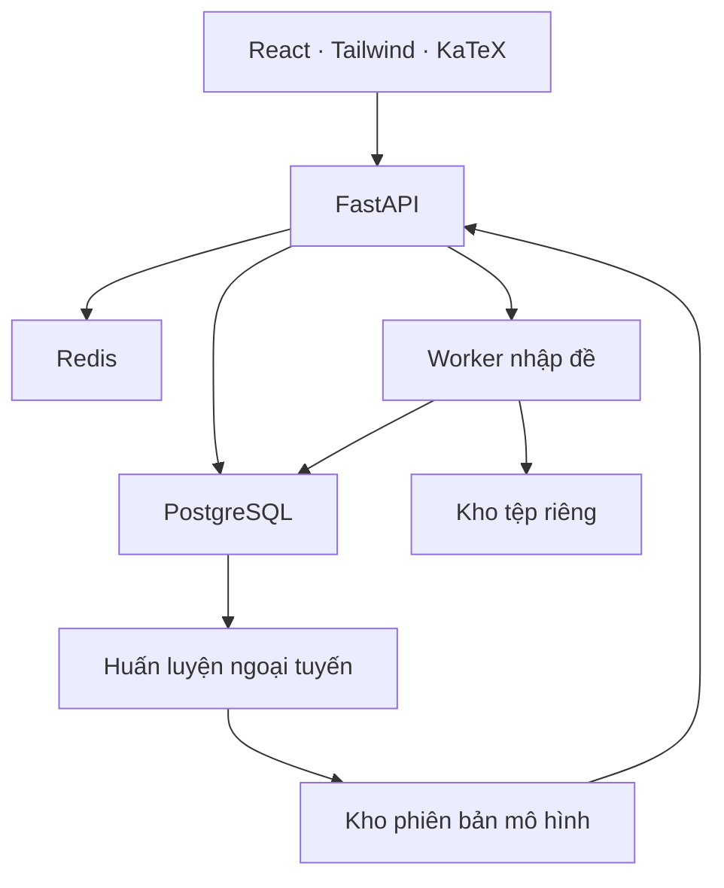
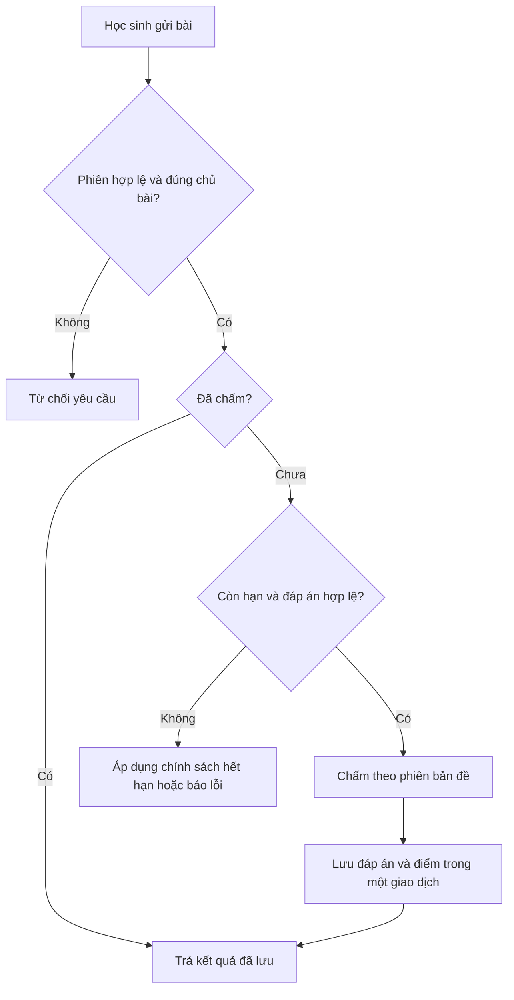
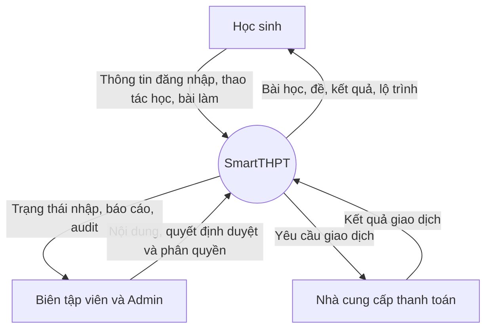
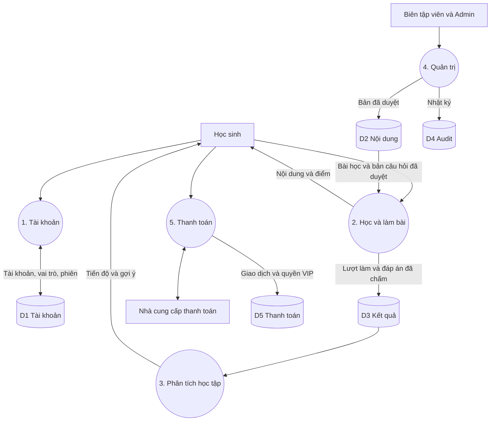
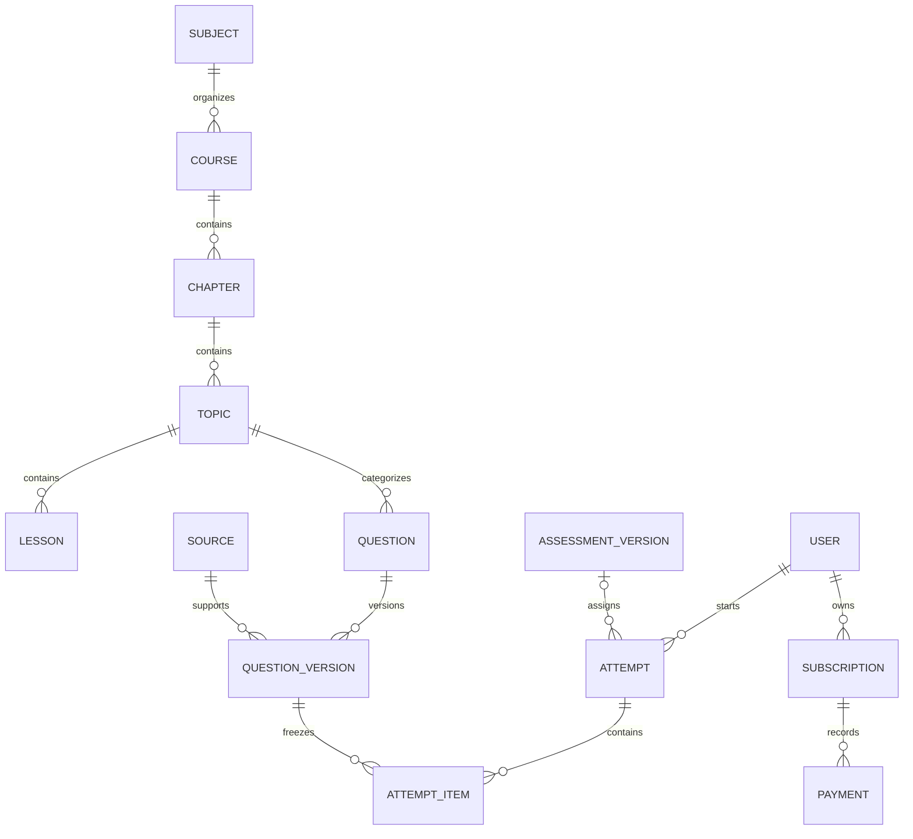

# Thiết kế hệ thống SmartTHPT v0.1

## Kiến trúc mục tiêu



FastAPI tổ chức theo tài khoản, nội dung, đánh giá, phân tích và thanh toán. PostgreSQL là nơi lưu dữ liệu nghiệp vụ. Redis hỗ trợ phiên, giới hạn tần suất và công việc nền khi triển khai. Quá trình huấn luyện chạy riêng. API chỉ nạp phiên bản đã duyệt. Hệ thống hiện chạy FastAPI, SQLite và JavaScript tĩnh.

API mục tiêu dưới `/api/v1` gồm `auth`, `catalog`, `lessons`, `attempts`, `insights`, `admin/imports` và `billing`. Giữ API nguyên mẫu khi chuyển từng luồng. Chuyển SQLite sang PostgreSQL bằng migration có đối chiếu số bản ghi và kiểm tra các bài đã chấm. Migrate lược đồ trước, diễn tập nhập dữ liệu sau, chuyển lưu lượng khi kiểm thử đạt.

## Use Case

| Tác nhân | Use Case | Luồng phụ |
|---|---|---|
| Học sinh | UC01–05, UC07, UC08, UC10 | Phiên hết hạn, thiếu câu phù hợp, nộp lặp, thiếu dữ liệu dự đoán, thanh toán chờ xử lý |
| Biên tập viên | UC06 | Tệp sai định dạng, câu trùng, thiếu bằng chứng quyền, bản nháp bị yêu cầu sửa |
| Admin | UC09, duyệt UC06 | Thu hồi phiên tài khoản khóa, lưu lịch sử duyệt, rà soát thay đổi vai trò |
| Nhà cung cấp thanh toán | UC10 | Webhook trùng, sai chữ ký, giao dịch hoàn tiền |

UC03/04 tạo bài. UC05 xử lý nộp và lưu kết quả. UC07 dùng kết quả đã lưu. UC08 đọc dự đoán từ mô hình đủ điều kiện. UC06 yêu cầu duyệt trước khi câu hỏi được dùng ở UC03/04.

## Activity Diagram — nộp bài



## DFD mức 0



## DFD mức 1



## ERD mục tiêu



| Nhóm | Ràng buộc chính |
|---|---|
| Danh mục | COURSE duy nhất theo lớp và môn. CHAPTER, TOPIC có thứ tự và slug duy nhất trong cha |
| Nội dung | QUESTION_VERSION duy nhất theo câu và số phiên bản. Lưu kiểu câu, dữ liệu chấm, lời giải, nguồn và trạng thái duyệt. ASSESSMENT_VERSION lưu danh sách phiên bản câu và biểu điểm |
| Đánh giá | ATTEMPT lưu người làm, hạn nộp, trạng thái, tổng điểm. ATTEMPT_ITEM lưu phiên bản câu, thứ tự, đáp án học sinh và điểm. Khóa hàng lúc chấm để xử lý đồng thời |
| Nhập và audit | IMPORT_BATCH giữ trạng thái và kết quả từng mục. AUDIT_EVENT giữ người thực hiện, đối tượng, thời điểm và hành động |
| Thanh toán | PAYMENT có khóa duy nhất theo mã giao dịch bên cung cấp. Thay đổi trạng thái thanh toán và quyền VIP trong cùng giao dịch |
| ML | MODEL_RUN tham chiếu phiên bản dữ liệu, Git SHA và metrics. PREDICTION tham chiếu run, mã học sinh, mốc thời gian và giá trị dự đoán |

## Quy trình Git và chạy trên Windows

Mỗi tính năng dùng nhánh `feat/...`, sửa lỗi dùng `fix/...`, tài liệu dùng `docs/...`. Mở PR vào `main` và đọc kết quả CI trước khi merge. Gọi script qua Python trong venv để tránh phụ thuộc ExecutionPolicy.

```powershell
Set-Location D:\SmartTHPT
git status --short
git fetch origin
git branch -vv
py -3.12 -m venv .venv
.\.venv\Scripts\python.exe -m pip install -r requirements-dev.txt
.\.venv\Scripts\python.exe -m unittest discover -s tests -v
.\.venv\Scripts\python.exe -m uvicorn app.main:app --host 127.0.0.1 --port 8000
```
